# vLLM V1 请求机制学习笔记

> 配套图：[vllm_request_flow.mmd](./vllm_request_flow.mmd) / [rendered/vllm_request_flow.svg](./rendered/vllm_request_flow.svg)

## 学习顺序

这份笔记按下面九步推进，每一步都是下一步的输入：

```text
1. 端到端路径（先看地图）
2. 进程边界和模块划分
3. 提交阶段
4. 排队阶段
5. KV Cache 分页
6. 调度决策
7. GPU 执行层
8. 优化机制
9. 输出与收尾
```

学习方法本身也是一个循环（见下图）：


---

# 1. 端到端路径（先看地图）

## 1.1 对象转换链

一次请求从进来到最后返回，对象是这样一层层变的：

```text
HTTP request
→ EngineInput / PromptType
→ EngineCoreRequest
→ Request
→ SchedulerOutput
→ ModelRunnerOutput
→ EngineCoreOutputs
→ RequestOutput
→ SSE chunk
```


> 颜色约定：蓝 = API 进程对象，橙 = EngineCore 对象，绿 = GPU 执行产物。每个箭头上的文字是"谁做的转换"。

## 1.2 一句话全流程

```text
用户
→ vLLM API 进程（收请求、tokenize、登记收件箱）
→ ZMQ 跨进程
→ EngineCore 进程（input_queue）
→ Scheduler.add_request（进入 waiting）
→ Scheduler.schedule（组队、分 token、分 KV）
→ Executor → Worker → GPU forward + sampling
→ Scheduler.update_from_output（写回状态）
→ EngineCoreOutputs
→ API 进程 output_handler
→ OutputProcessor（detokenize、stop string）
→ generate() → SSE
```


## 1.3 先记住两个方向

```text
提交方向：API → EngineCore
输出方向：EngineCore → API
```

两个方向方向相反，所以 vLLM 需要两条通道：输入通道和输出通道。

## 1.4 本章要记住的结论

- 请求不是直接到 GPU，先到 API 进程，再到 EngineCore 进程；
- 一次 engine step 不等于一次 SSE 输出；
- 请求进入 waiting 后，真正开始算要等调度器挑选。

---

# 2. 进程边界和模块划分

## 2.1 两个进程角色

```text
API 进程（前台）
  - 收 HTTP 请求
  - tokenize
  - 提交 EngineCoreRequest
  - 接收输出并转成 SSE

EngineCore 进程（厨房）
  - busy loop
  - Scheduler
  - KV Cache Manager
  - Executor
  - Worker 进程（真正持模型跑 GPU）
```


## 2.2 六个大模块

| 模块 | 主要源码 | 职责 |
| --- | --- | --- |
| HTTP/OpenAI API 层 | `vllm/entrypoints/openai/` | 收 HTTP、套 template、tokenize、转 SSE |
| AsyncLLM / EngineClient | `vllm/v1/engine/async_llm.py` | 转成 EngineCoreRequest，跨进程提交和输出路由 |
| EngineCore | `vllm/v1/engine/core.py` | busy loop、请求生命周期、engine step |
| Scheduler + KV Cache | `vllm/v1/core/sched/scheduler.py` | 排队、调度、token budget、KV 分配、抢占 |
| Executor + Worker | `vllm/v1/executor/`、`vllm/v1/worker/` | 分发任务、GPU forward、sampling |
| OutputProcessor | `vllm/v1/engine/output_processor.py` | detokenize、logprobs、stop string、生成 RequestOutput |

模块之间的层级与"谁持有谁"（含创建关系）：


## 2.3 谁管什么

```text
EngineCore：做决定（调度、状态、KV 账本）
Executor：派活（管理 Worker）
Worker：真正干活（GPU forward、sampling）
```

## 2.4 本章要记住的结论

- 不是每个请求一个进程，进程数由启动配置决定；
- EngineCore 和 Worker 不是同一个概念；
- Scheduler 管“该跑什么”，Worker 管“怎么算出来”。

---

# 3. 提交阶段

## 3.1 HTTP 到 EngineInput

`OpenAIServingChat._create_chat_completion` 负责：

1. 校验请求；
2. 套 chat template；
3. tokenize；
4. 处理多模态输入；
5. 得到 `EngineInput`。

例子：

```text
用户发 "你好"
→ 套 template 后变成一段模型输入文本
→ tokenizer 切成 [151644, 8948, 13, ...]
→ 得到 EngineInput
```

## 3.2 EngineInput 到 EngineCoreRequest

`AsyncLLM.add_request` 调用 `InputProcessor`：

- 已渲染的 `EngineInput` 走同步处理；
- 原始 prompt 走异步处理，避免 tokenizer 阻塞事件循环。

输出是 `EngineCoreRequest`，包含：

```text
request_id
prompt token IDs
SamplingParams
LoRA、priority、trace headers 等
```

## 3.3 先登记收件箱，再递交

`_add_request` 的顺序很重要：

```text
1. output_processor.add_request(...)
   → API 进程先登记输出状态和 RequestOutputCollector
2. engine_core.add_request_async(...)
   → 再把 EngineCoreRequest 发给 EngineCore
```

先挂收件箱，再递工作单，避免输出回来时找不到地方放。

提交阶段的完整时序（登记收件箱 → 递交 → EngineCore 收到 ADD）：

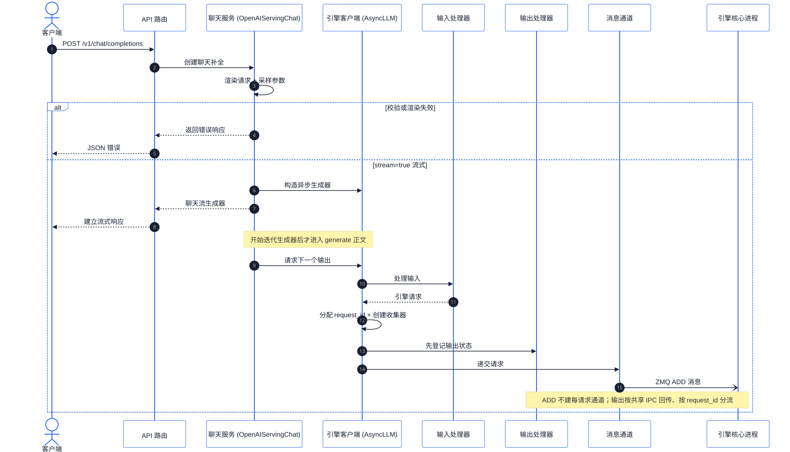

## 3.4 n > 1 时

如果 `SamplingParams.n > 1`，一个外部请求会展开成多个内部 child requests，之后由 `ParentRequest` 聚合。

## 3.5 本章要记住的结论

- 提交阶段不碰 GPU；
- `EngineCoreRequest` 是跨进程传递的工作单；
- 收件箱必须先于工作单准备好。

---

# 4. 排队阶段

## 4.1 input_queue：跨进程过道

API 进程把 `EngineCoreRequest` 发到 EngineCore，EngineCore 接收线程解码后放进 `input_queue`：

```text
API 进程
  A、B、C 并发任务
  → 各自发一条消息

input_queue（同一条共享队列）

EngineCore 进程
  → busy loop 取出
```

不是每个请求一个进程，A、B、C 只是队列里的消息。

## 4.2 input_queue 的顺序

`input_queue` 是 FIFO，但它是“提交完成并发送消息的顺序”，不一定等于 HTTP 到达顺序。

原因：API 进程并发处理，tokenize 快慢不同，后到的请求可能先完成预处理、先入队。

## 4.3 Scheduler.add_request

`Scheduler.add_request` 做三件事：

```text
self.requests[request_id] = request
放进 waiting 队列
记录 QUEUED 事件
```

如果请求一开始就是阻塞态，会直接进 `skipped_waiting`。

## 4.4 waiting / running / skipped_waiting

```text
waiting：还没上 GPU，正常排队
skipped_waiting：暂时不能调度，但没结束
running：正在参与 GPU batch
```

`skipped_waiting` 常见出现原因：

```text
等 structured output grammar 编译
等远端 KV 异步加载
等 streaming input 下一个 chunk
LoRA 数量达到上限
多模态 encoder cache 未就绪
旧输出还在途中
```

条件恢复后，请求会被“升级”回 `WAITING` / `PREEMPTED`，继续参与调度。

请求状态机的完整流转：


## 4.5 priority 排序

比较顺序：

```text
priority 小者优先
→ arrival_time 早者优先
→ request_id 小者优先
→ 对象 id
```

`priority` 默认 0，由请求方传入，不是 Scheduler 自动生成。

例子：

```text
请求 A：priority=0，到达时间 10:00:01
请求 B：priority=1，到达时间 10:00:00

A 先被调度，因为 priority 0 < 1，哪怕 B 更早到达。
```

## 4.6 本章要记住的结论

- `input_queue` 只是过道，真正的排队在 Scheduler；
- waiting 的顺序不等于最终执行顺序，priority 可以重排；
- `skipped_waiting` 不是失败，只是暂时不能跑。

---

# 5. KV Cache 分页

## 5.1 为什么需要分页

请求长度动态、结束时间不同，连续分配会产生碎片和浪费。

例子：

```text
请求 A 占用物理 0-3，完成后释放
请求 D 需要 10 块，但空闲只有 0-3 和 12-17

连续分配：无法满足
分页分配：D 可以同时使用 0-3 和 12-17
```

## 5.2 物理 block

KV Cache 是一块预分配的连续显存，但内部按固定大小切块：

```text
[物理 block 0][物理 block 1] ... [物理 block N]
```

每个 block 默认能装 16 个 token 的 K/V。

`block_size` 默认 16，可配置，不同平台/混合模型可能不同。

## 5.3 BlockPool

`BlockPool` 管理物理 block 元数据：

```text
get_new_blocks：分配空闲 block
free_blocks：请求结束还 block
cache_full_blocks / get_cached_block：prefix cache
touch：更新使用热度
```

BlockPool 管理的是 block 编号和引用，不是直接持有 GPU 地址。

## 5.4 逻辑 block 与物理 block

```text
token 0-15   → 逻辑 block 0 → 物理 block 100
token 16-31  → 逻辑 block 1 → 物理 block 37
```

逻辑层让请求的 token 顺序连续，物理层可以分散。

“逻辑 block”不是多余的一层，它只是给 16 个 token 的分组起了名字，让 block table 更短。

## 5.5 block table

block table 是请求自己的映射：

```text
逻辑 block 0 → 物理 block 100
逻辑 block 1 → 物理 block 37
逻辑 block 2 → 物理 block 5
```

GPU 按表找数据，物理位置乱不乱无所谓。

逻辑 / 所有权 / 执行三层的完整视图：


## 5.6 slot mapping

`slot_id` 是扁平 KV 张量里的槽索引：

```text
slot_id = 物理 block 号 × block_size + block 内偏移
```

它不是内存地址。kernel 拿到后会拆回：

```text
block_idx   = slot_id // block_size
block_offset = slot_id % block_size
```

然后用 `(block_idx, block_offset)` 定位真正的 KV 张量位置。

## 5.7 PagedAttention

PagedAttention = 分页 KV Cache + 能跨 block 做 attention 的 kernel。

```text
query 是第 47 个 token
→ 按 block table 顺序访问物理 block
→ 读 block 100（token 0-15）
→ 读 block 37（token 16-31）
→ 读 block 5（token 32-47）
→ 算 score、softmax、累加 V
```

收益：

- 显存利用率高；
- 碎片少；
- 长对话按需增长；
- 相同前缀可共享；
- 支持变长 batch。

block table → slot mapping → attention kernel 的执行路径：


## 5.8 本章要记住的结论

- 物理 block 是 KV 显存块的编号，不是地址；
- slot_id 是槽索引，不是地址；
- 逻辑连续由 block table 保证，物理位置可以分散。

---

# 6. 调度决策

## 6.1 三个账本

| 账本 | 回答的问题 | 关键对象 |
| --- | --- | --- |
| 请求状态 | 现在能不能跑 | `Request.status`、waiting、running |
| token 进度 | 算了多少、还欠多少 | `num_computed_tokens`、`num_tokens_with_spec` |
| KV 所有权 | block 属于谁、放在哪 | `KVCacheManager`、BlockPool、block table |

例子：

```text
刚到达：WAITING，num_computed=0，无 KV
被调度：RUNNING，分配 token 和 KV
执行完：写回 token、进度、结束状态
被抢占：PREEMPTED，进度清零，KV 释放
结束：FINISHED，KV 全部释放
```

## 6.2 schedule 主流程

```text
初始化 token_budget

第一遍：running 请求
  - 计算还欠多少 token
  - 裁剪 budget / max_model_len
  - allocate_slots() 分配 KV
  - KV 不够 → 抢占一个 running 请求

第二遍：waiting 请求
  - 按 FCFS / priority 挑请求
  - 检查 max_num_running_reqs、阻塞状态、LoRA 等
  - 分配 token 数和 KV blocks
  - 不能调度的放 skipped_waiting

生成 SchedulerOutput
```

调度决策的完整流程图（含抢占分支）：


## 6.3 谁上 GPU

```text
第一优先：已经在 running 的请求
第二优先：waiting / skipped_waiting 里的请求
```

waiting 请求能进入还要满足：

```text
running 数量未达到 max_num_running_reqs
请求不在阻塞状态
LoRA / grammar / 多模态限制满足
KV 空间足够
token_budget 还有余额
```

## 6.4 每轮算多少 token

每个请求有“欠账”：

```text
还欠 = 目标长度 - 已经算完的位置
```

本轮能算多少取最小值：

```text
n = 还欠的 token
n = min(n, token_budget)
n = min(n, max_model_len 剩余)
n = min(n, encoder budget)
```

## 6.5 token budget

`token_budget` 是一轮 engine step 内允许处理的总 token 位置数，不是“本轮产生多少输出 token”。

例子：

```text
budget = 100

running：A，decode，还欠 1 → 算 1
waiting：B，prompt 60 → 算 60
waiting：C，prompt 20 → 算 20
waiting：D，decode → 算 1
剩余 budget = 18
```

默认值通常来自 `max_num_batched_tokens`。KV Cache 大小是启动时自动 profiling 的，但 token budget 本质是超参数，可手动调。

## 6.6 allocate_slots 与抢占

每轮分配 token 前都要确认 KV：

```text
allocate_slots() 成功 → 安排这个请求
allocate_slots() 返回 None → KV 满了
```

KV 满时，在 running 阶段会抢占：

```text
FCFS：抢 running 列表最后一个
priority：抢 priority 最大的请求
→ 释放其 KV
→ 让给当前需要 KV 的请求
→ 被抢占者回 waiting
```

常见误解：

- 不是“把资源给简单任务”；
- 是“抢一个正在跑的请求，让给当前需要 KV 的请求”；
- waiting 里的新请求拿不到 KV 时，不会触发抢占，只会继续等。

## 6.7 SchedulerOutput

调度结束后生成 `SchedulerOutput`：

```text
本轮每个请求算多少 token
新分配的 KV blocks / block table
采样、grammar、spec decode 等元数据
```

这就是 GPU 执行层的“执行合同”。

## 6.8 本章要记住的结论

- 先推进 running，再接纳 waiting；
- token budget 限制每轮总工作量；
- KV 不够会触发抢占，代价是之后重算。

---

# 7. GPU 执行层

## 7.1 EngineCore.step

EngineCore 每轮执行：

```text
Scheduler.schedule
→ Executor.execute_model(non_block=True)
→ 等待 future
→ 必要时 sample_tokens
→ 处理执行期间到达的 abort
→ Scheduler.update_from_output
→ EngineCoreOutputs 入队
→ post_step 可选更新
```

EngineCore 主循环的完整流程：


## 7.2 Executor 做什么

```text
选择分布式后端（mp / ray / uni）
管理 Worker 进程
加载模型、初始化 KV Cache、预热
把 SchedulerOutput 分发给 Worker
收集 ModelRunnerOutput
```

## 7.3 Worker / Model Runner 做什么

```text
准备 input IDs、positions、长度
准备 block table、slot mapping、attention metadata
执行 model forward
得到 logits
交给 Sampler
得到新 token
```

## 7.4 forward 与 sampling

一次 forward 处理本轮被调度的 token 位置，不产生固定数量 token：

```text
decode：通常每请求 1 个输出 token
prefill chunk：可能 0 个输出 token
speculative decoding：可能多个
```

runner forward + sampling 的完整路径：


## 7.5 ModelRunnerOutput 回传

Worker 返回 `ModelRunnerOutput` 后，`Scheduler.update_from_output` 写回：

```text
追加新 token
更新 num_computed_tokens
检测 stop / max_tokens
释放结束请求的 KV
生成 EngineCoreOutputs
```

## 7.6 本章要记住的结论

- Scheduler 决定“该跑什么”，Executor 决定“怎么分派”，Worker 真正“算出来”；
- logits 还不是 token，sampling 之后才是；
- 一次 engine step 不等于一次 SSE 输出。

---

# 8. 优化机制

## 8.1 Prefix Caching

机制：

```text
完整 block 计算完成后，按内容生成 hash
新请求用 hash 查找已计算的物理 block
命中就直接引用，只计算未命中的后缀
```

全部命中时仍要重算最后一个 token：

```text
KV Cache 存的是历史上下文，不是预测结果
要采样下一个 token，必须有最后一个 prompt 位置的 logits
→ 重算最后一个位置
→ 拿 logits → 采样
```

prefix cache 块从查找到释放的完整生命周期：


取舍：

```text
用显存换计算：
  命中多 → 吞吐和 TTFT 更好
  命中少 → 缓存占显存，只有账本开销
```

## 8.2 Chunked Prefill

问题：

```text
一个长 prompt 一次 prefill 占满整轮，短请求和 decode 被堵住
```

机制：

```text
还欠 3000 token，budget 2048
→ 本轮算 2048
→ num_computed_tokens = 2048
→ 下一轮再算剩余 952
```

每轮可以混合 prefill chunk 和 decode 请求。

取舍：

| 方向 | 效果 |
| --- | --- |
| 吞吐 | prefill + decode 混合，GPU 利用率更好 |
| 延迟 | 短请求和 decode 更稳定 |
| 长请求 TTFT | 变长，因为要分多轮 |
| 开销 | 每多一个 chunk，多一次调度和 forward |

## 8.3 Continuous Batching

静态批处理：

```text
凑满一批 → 全部跑完 → 下一批
```

continuous batching：

```text
每轮重新组队：
  schedule() 组队
  → execute_model() 算一轮
  → update_from_output() 清理结束请求
  → 下一轮再 schedule()
```

结束的请求立即腾位置，等待的请求下一轮补进来，GPU 每轮都有活干。

连续批处理的 engine step 循环：


## 8.4 抢占恢复

触发条件：

```text
KV 池不足，allocate_slots() 返回 None
```

机制：

```text
选择被抢占者（FCFS 最后一个 / priority 最低）
释放其 KV blocks
num_computed_tokens 清零
状态 = PREEMPTED
放回 waiting
之后重新调度并重算
```

代价：

```text
之前算过的 token 白算
被抢占请求延迟大幅增加
系统不会 OOM，但吞吐和尾延迟变差
```

## 8.5 三个机制怎么一起取舍

```text
Prefix caching：  用显存换计算
Chunked prefill： 用长请求 TTFT 换全体延迟和利用率
抢占恢复：       用重算换系统稳定
```

长 prompt 是否独占：

```text
默认 FCFS 下，队头长 prompt 会优先吃预算
但 chunked prefill 限制单轮量
可用 long_prefill_token_threshold 或 priority 调整公平性
```

各高级能力（多模态 / structured output / LoRA / spec decode / 并行）挂载在主链的哪个环节：


## 8.6 本章要记住的结论

- 三个机制没有纯赚，都是拿一种资源换另一种；
- 它们都发生在 Scheduler 的同一套账本上；
- 频繁抢占说明 KV 配置太小，应该调显存或并发。

---

# 9. 输出与收尾

## 9.1 输出回传路径

```text
EngineCoreOutputs
→ output_handler（API 进程）
→ OutputProcessor.process_outputs
→ IncrementalDetokenizer
→ RequestOutput
→ RequestOutputCollector
→ generate()
→ chat_completion_stream_generator
→ SSE chunk
```

输出回传 + 各类终止路径（stop string / 取消 / 错误）的完整时序：

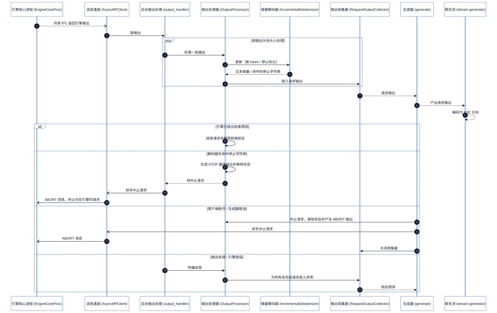

## 9.2 一次 engine step 不等于一次 SSE

```text
output_handler 按 chunk 处理 EngineCoreOutputs
FINAL_ONLY / DELTA / stream_interval 决定用户可见频率
```

## 9.3 停止、取消、错误

```text
stop token：Scheduler / EngineCore 状态层判断
stop string：detokenizer 发现，API 侧反向 abort EngineCore
max tokens：长度上限结束
client cancellation：取消 generate()，先清理 API 侧，再通知 EngineCore
engine error：作为错误传播，不伪装成普通 abort
```

## 9.4 本章要记住的结论

- 输出方向和提交方向相反；
- 一次 engine step 可以产生多个请求的输出，也可以一轮都不产生 SSE；
- 所有结束路径都必须让 EngineCore 和 API 侧状态保持一致。

---

# 附录 A：常见疑问速查

## Q1：每个请求都会开一个进程吗？

不会。进程启动时创建，请求只是队列里的消息。

## Q2：input_queue 是按 HTTP 到达顺序吗？

不严格。按“提交完成并发送消息”的顺序，tokenize 快慢可能导致顺序变化。

## Q3：priority 是自动生成的吗？

不是。请求方传入，默认 0；Scheduler 只负责比较。

## Q4：物理 block 是内存地址吗？

不是。物理 block 是 KV 显存块的编号，真正的地址由 kernel 计算。

## Q5：slot_id 是什么？

扁平 KV 张量里的槽索引：

```text
slot_id = 物理 block 号 × block_size + block 内偏移
```

kernel 会把它拆回 block_idx 和 block_offset。

## Q6：block size 固定吗？

同一个 cache group 内固定，默认 16，可配置；不同平台/混合模型可能不同。

## Q7：一次 forward 会产生固定数量 token 吗？

不会。forward 处理的位置数由 Scheduler 决定，输出 token 数由采样位置决定。

## Q8：为什么 prefix cache 全部命中还要重算最后一个 token？

因为 KV Cache 没有存 logits，要采样下一个 token，必须有最后一个位置的 logits。

## Q9：抢占是把资源给简单任务吗？

不是。是抢一个正在跑的请求，让给当前需要 KV 的请求；选择标准是策略，不是复杂度。

## Q10：为什么不能直接连续存 KV？

因为请求长度动态、结束时间不同，连续分配会产生碎片和浪费；分页用 block table 解决。

## Q11：最核心的模块是什么？

取决于定义：

```text
产生 token 的核心：Worker / Model Runner / Sampler
让 vLLM 高效的核心：EngineCore + Scheduler + KV Cache
```

---

# 附录 B：关键源码入口

- `vllm/entrypoints/openai/chat_completion/api_router.py`
- `vllm/entrypoints/openai/chat_completion/serving.py`
- `vllm/v1/engine/async_llm.py`
- `vllm/v1/engine/core_client.py`
- `vllm/v1/engine/core.py`
- `vllm/v1/core/sched/scheduler.py`
- `vllm/v1/core/sched/request_queue.py`
- `vllm/v1/core/kv_cache_manager.py`
- `vllm/v1/core/block_pool.py`
- `vllm/v1/worker/gpu/block_table.py`
- `vllm/v1/worker/gpu_model_runner.py`
- `vllm/v1/engine/output_processor.py`

